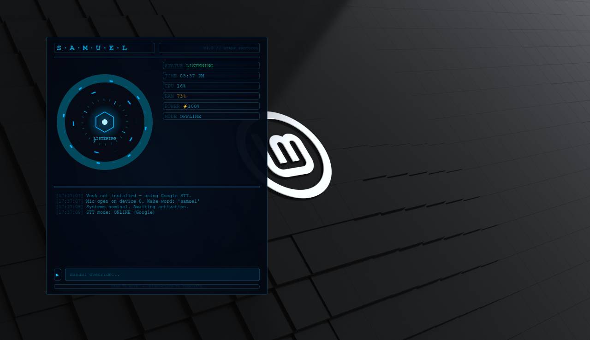

# S.A.M.U.E.L.

A JARVIS-inspired personal voice assistant for Linux, written in Python with a PyQt6 heads-up display. I built it for my own use on an old Dell Latitude E5410 with 4GB of RAM, so it is designed to stay lightweight and work offline.

## What it does

- Animated arc-reactor HUD with a live console log (PyQt6)
- Offline speech-to-text with Vosk, with a Google Speech fallback when the model is missing
- Spoken replies using Piper text-to-speech
- Looks up questions on Wikipedia and reads back a short summary
- Reports laptop battery and system status using psutil

## Design choices

- **Offline-first.** Voice recognition and speech run locally, and the network is only a fallback.
- **Low-resource.** It uses the small Vosk model and a medium Piper voice so it runs on 4GB of RAM.
- **Threaded.** Audio listening runs in a background thread and talks to the UI through Qt signals, so the HUD never freezes.

## Setup

    sudo apt install portaudio19-dev
    pip install -r requirements.txt

Download the models and place them in `~/samuel_voice/`:

- Vosk model: vosk-model-small-en-in-0.4 from https://alphacephei.com/vosk/models
- Piper binary and the en_GB-alan-medium voice from https://github.com/rhasspy/piper

## Run

    python3 samuel_v4.py

## Status

This is v4. I am splitting the single file into modules (UI, core logic, voice).
