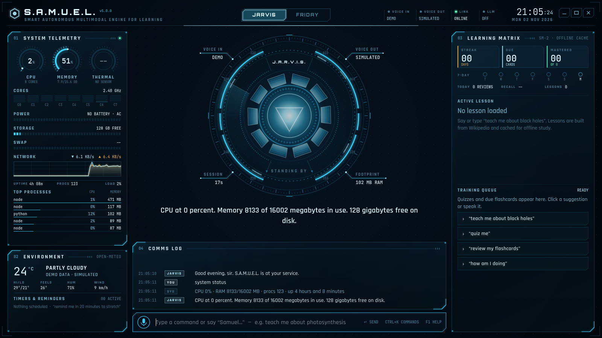
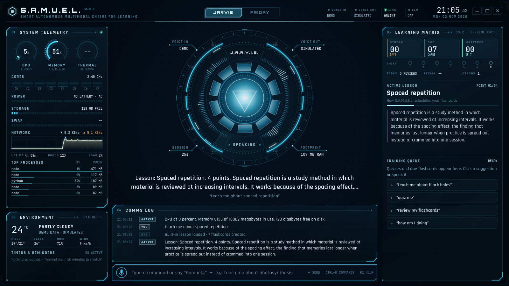
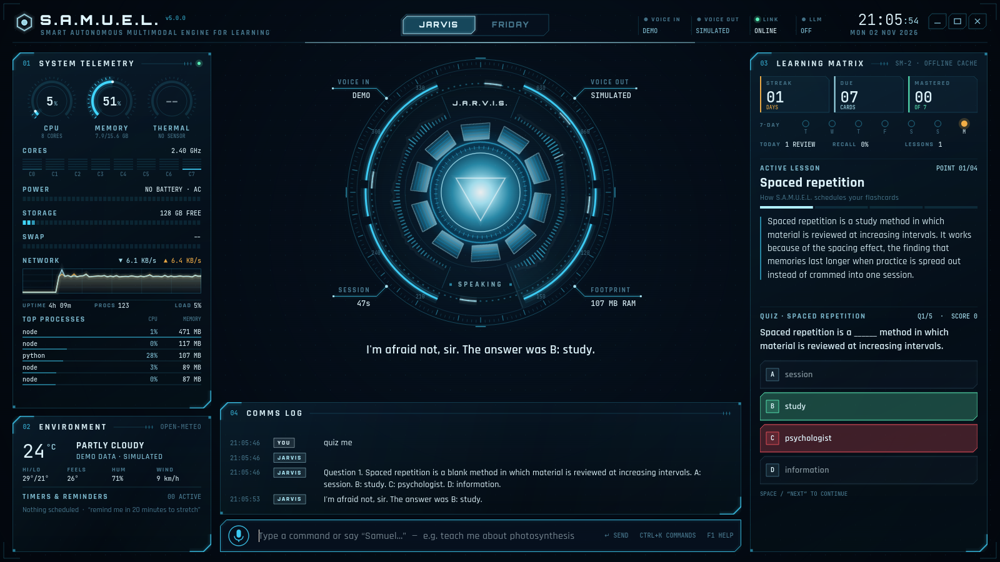
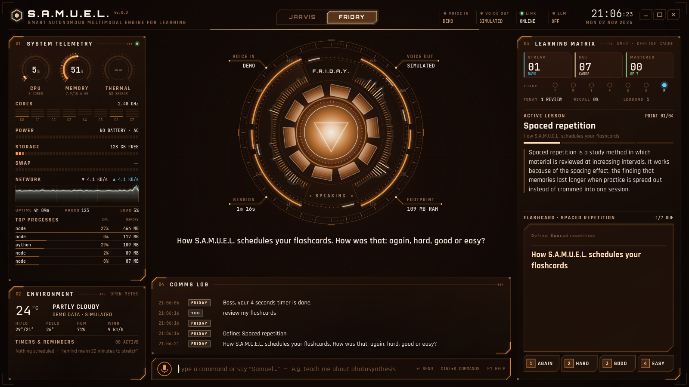
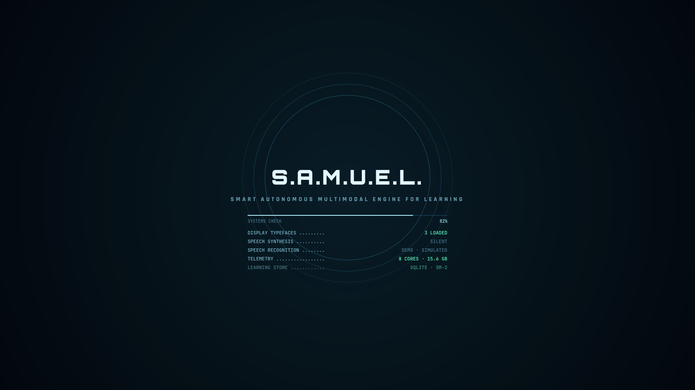

# S.A.M.U.E.L.

**Smart Autonomous Multimodal Engine for Learning.** A JARVIS-inspired personal voice assistant for Linux, written in Python with a PyQt6 heads-up display. I built it for my own use on an old Dell Latitude E5410 with 4 GB of RAM, so it is designed to stay lightweight and work offline.

> **Branch `grok/jarvis-hud`.** This branch adds v5: a redesigned JARVIS/FRIDAY HUD and a modular package. `samuel_v4.py` is left exactly as it was and still runs.

| | |
| --- | --- |
|  |  |
|  |  |

All twelve states are in [`screenshots/v5/`](screenshots/v5/), including listening, alert, command palette and help. They were rendered headlessly by `tools/capture_screens.py`.

## What v5 does

**The HUD**
- Arc-reactor centrepiece: a compass tick ring, segmented and counter-rotating rings, a radar sweep, ten reactor coils and a radial voice waveform. It reacts to five states: idle, listening (ripples), thinking (fast spin and tracers), speaking (driven by the real loudness of the Piper audio) and alert (reminders).
- Two personas. **JARVIS** has an ice-blue theme, says "sir" and uses the `en_GB-alan-medium` voice. **FRIDAY** has an amber theme, says "boss" and uses `en_GB-jenny_dioco-medium`. Switching cross-fades every colour on screen. Say "switch to Friday" or "Jarvis, take over", press Ctrl+P, or click the switch in the top bar.
- Live telemetry: CPU, memory and temperature gauges, per-core bars, battery, disk, swap, a network sparkline, the top processes by RAM, uptime.
- Environment panel: Open-Meteo weather once you set a city, plus timers and reminders with live countdowns. Reminders survive restarts.
- Comms log with a typewriter effect, subtitles of what it says and what it heard, a command bar (with history on ↑/↓), a Ctrl+K command palette and an F1 manual.
- A boot sequence that lists real start-up checks (fonts, voice in and out, LLM). The window is frameless and draggable; double-click the top bar or press F11 for fullscreen.

**Learning (the main job)**
- "Teach me about black holes" fetches the Wikipedia summary and splits it into points, which it reads one at a time ("next", "repeat"). Lessons are cached in SQLite for offline study.
- It makes flashcards automatically (cloze deletions from the lesson text) and schedules them with **SM-2** spaced repetition. Say "review my flashcards", answer aloud or flip the card, then grade it Again/Hard/Good/Easy (keys 1–4).
- "Quiz me": multiple-choice questions built from the lesson. Answer by saying "B", pressing 1–4 or clicking.
- Progress shows your streak, last 7 days, cards due, mastered cards and today's recall rate.
- A built-in lesson on spaced repetition works with no internet (it is used by the demo).

**Assistant skills**: time and date, a daily briefing, system status, battery, weather, timers, reminders ("remind me at 18:30 to call mum"), notes (`~/Documents/SAMUEL_Notes/study_notes.md`, the same as v4), Wikipedia answers, jokes, opening apps from an allow-list, YouTube and Google searches, volume, brightness, a full-screen screenshot, locking the screen, and window control. Everything you can say is listed in F1.

**Optional LLM**: off by default. You can point it at a local [Ollama](https://ollama.com) model or any OpenAI-compatible endpoint. It is only used for questions no built-in skill handles.

## Setup

    sudo apt install portaudio19-dev        # only needed for the microphone
    pip install -r requirements.txt

v5 itself needs only **PyQt6, psutil and requests**. Vosk, PyAudio and SpeechRecognition are optional; without them you type instead of talking. `wikipedia` and `pyautogui` are only used by `samuel_v4.py`. **v5 adds no new dependencies.** The three fonts are bundled (SIL Open Font License, texts in `samuel/ui/fonts/`).

Models go in `~/samuel_voice/`, the same place as v4:

| What | Where | Source |
| --- | --- | --- |
| Vosk model `vosk-model-small-en-in-0.4` | `~/samuel_voice/vosk-model-small-en-in-0.4/` | https://alphacephei.com/vosk/models |
| Piper binary | `~/samuel_voice/piper/piper` (a `piper` on your PATH also works, e.g. `pip install piper-tts`) | https://github.com/rhasspy/piper/releases (archived; development moved to https://github.com/OHF-Voice/piper1-gpl) |
| JARVIS voice `en_GB-alan-medium.onnx` + `.onnx.json` | `~/samuel_voice/piper/` | https://huggingface.co/rhasspy/piper-voices |
| FRIDAY voice `en_GB-jenny_dioco-medium.onnx` + `.onnx.json` (optional) | `~/samuel_voice/piper/` | same |

Piper has no Irish-English voice, so FRIDAY can't sound like Kerry Condon. Other British female voices that exist: `en_GB-cori-medium`, `en_GB-alba-medium`, `en_GB-southern_english_female-low`. Set `voice_friday` in the settings to use one.

## Run

    python3 -m samuel              # or: python3 samuel_v5.py
    python3 -m samuel --demo       # scripted tour: simulated voice, throwaway data, no mic needed
    python3 -m samuel --lite       # lighter rendering for old laptops
    python3 samuel_v4.py           # the original, unchanged

Other flags: `--no-voice`, `--no-boot`, `--fullscreen`, `--persona friday`, `--size 1366x768`, `--config PATH`.

Say **"Samuel"**, **"Jarvis"** or **"Friday"**, then a command. You can also press Ctrl+Space (or click the mic) and speak, or just type.

## Settings

    python3 -m samuel --write-config     # writes ~/.config/samuel/config.json with every default

Any key you leave out keeps its default. Useful ones:

| Key | Default | Notes |
| --- | --- | --- |
| `weather_city` or `weather_lat`/`weather_lon` | empty | Weather stays off until set |
| `persona` | `jarvis` | or `friday` |
| `honorific_jarvis` / `honorific_friday` | `sir` / `boss` | |
| `voice_jarvis` / `voice_friday` | Piper `.onnx` paths | |
| `vosk_model`, `piper_exe`, `mic_device_hint` | as v4 | |
| `llm_backend` | `off` | `ollama` (uses `ollama_url`, `ollama_model`) or `openai` (uses `openai_base_url`, `openai_model`) |
| `llm_key_env` | `SAMUEL_LLM_API_KEY` | The **name** of the environment variable holding a cloud key. Keys are never stored in the code or the config. |
| `lite`, `fps`, `idle_fps`, `start_fullscreen`, `boot_sequence` | `false`, 30, 15, `false`, `true` | |

Environment overrides: `SAMUEL_CONFIG`, `SAMUEL_DATA_DIR` (default `~/.local/share/samuel`), `SAMUEL_VOICE_DIR`.

## Keyboard

| Key | Action |
| --- | --- |
| Ctrl+K | Command palette |
| F1 | Operator manual |
| Ctrl+P | Switch JARVIS ⇄ FRIDAY |
| Ctrl+Space | Push to talk |
| `/` or Ctrl+L | Focus the command bar |
| 1–4 | Answer the quiz or grade the flashcard |
| Space | Flip the card or go to the next question |
| F11 / Esc | Fullscreen / leave fullscreen, close an overlay or stop speaking |
| Ctrl+S | Save a PNG of the HUD |
| Ctrl+D | Demo tour |
| Ctrl+Q | Quit |

## Architecture

    samuel/
      app.py            wiring: settings → Bus → brain/voice threads → HUD; CLI flags
      config.py         settings dataclass + JSON file
      personas.py       JARVIS / FRIDAY: names, palettes, lines, honorifics
      demo.py           scripted tour for --demo / Ctrl+D
      core/
        bus.py          Qt signals: the only way threads talk to the HUD
        brain.py        one worker thread + queue; runs every skill and learning session
        commands.py     intent parser (word boundaries, spoken numbers, durations, clock times)
        telemetry.py    psutil probes (+ sysfs battery fallback from v4)
        reminders.py    timers/reminders persisted to JSON
        system_control.py  volume, brightness, lock, apps allow-list, URLs, notify-send
        weather.py      Open-Meteo (geocoding + forecast, cached 15 min)
        knowledge.py    Wikipedia REST/OpenSearch, jokes, optional LLM
      learning/
        lessons.py      lesson points, key terms, cloze cards, quiz questions
        srs.py          SM-2 scheduler and streaks
        store.py        SQLite: lessons, cards, reviews
        sample.py       built-in offline lesson
      voice/
        tts.py          Piper → aplay streaming with live loudness; espeak or silent fallback
        stt.py          Vosk listener (wake words, command window), Google fallback
        audio.py        RMS level + pure-Python resampler (audioop is gone in Python 3.13)
      ui/
        hud.py          main window, layout, shortcuts, animation state
        theme.py        fonts + palette cross-fade
        anim.py         one shared animation clock + easing
        paint.py        chamfered frames, fake glow, helpers
        widgets/        reactor, gauges, telemetry, learning, console, chrome (top bar, palette, overlays)
    tests/              unit tests (python -m unittest)
    tools/capture_screens.py   headless screenshots + CPU/RAM metrics
    docs/RESEARCH.md    the research behind the design, with sources

Design notes, sources and the reasoning behind the palette, fonts and performance budget are in [`docs/RESEARCH.md`](docs/RESEARCH.md).

**What changed from v4, beyond the look**
- Commands are matched on whole words, so "set a timer" no longer triggers "time".
- Voice can't run arbitrary shell commands. Apps open from an allow-list, and no `shell=True`.
- Right-click no longer kills the app.
- Works on Python 3.13, where `audioop` was removed.
- Weather, notes, reminders and learning data are stored under the paths above.

## Performance

These figures were measured with `tools/capture_screens.py` on an 8-core Xeon VM with offscreen Qt rendering. **They were not measured on the E5410**, so expect a 2010 CPU to need a larger share.

| | 1600×900 | 1366×768 |
| --- | --- | --- |
| RAM (whole app, RSS) | ~100–110 MB | ~97 MB |
| CPU, idle (15 fps) | ~12 % of one core | ~9 % |
| CPU, standby (8 fps after 45 s quiet) | ~7.5 % | ~6 % |
| CPU, idle with `--lite` | — | ~5.6 % |

Animation stops completely while the window is minimised.

## Tests

    python3 -m unittest

There are 36 tests covering the command parser (including v4's "timer" vs "time" bug), durations and clock times, SM-2 intervals and ease factor, streaks, lesson/cloze/quiz generation, the SQLite store, reminders, the resampler, settings loading and shutdown handling.

## Honest limitations

- I couldn't test it with a real microphone, speakers, Piper or Vosk: the build machine has none. Those paths are written against the documented APIs and fall back cleanly. Without PyAudio it runs as "text only", and without Piper/aplay it runs "silent", which is how the screenshots were made. Please try voice on the laptop and report what breaks.
- Quizzes and flashcards are generated by rules from Wikipedia text, not by an AI. Most are good, but some blanks pick an odd word. Grade a bad card "easy" and it will rarely come back.
- Brightness needs `brightnessctl` or `xbacklight`; volume needs `pactl` or `amixer`. Screen locking and full-screen screenshots depend on your desktop. On Wayland, the Qt screenshot may need `gnome-screenshot` or `grim`.
- The optional LLM on 4 GB of RAM is only realistic with the smallest models (e.g. `qwen2.5:0.5b`), and it will be slow on a 2010 CPU.
- FRIDAY's amber theme is my interpretation of the Civil War-era HUDs, not an official palette.
- Not affiliated with Marvel. JARVIS and FRIDAY are used here as personal-project personas.

## Status

v5 lives on the `grok/jarvis-hud` branch. `main` and `samuel_v4.py` are unchanged.
